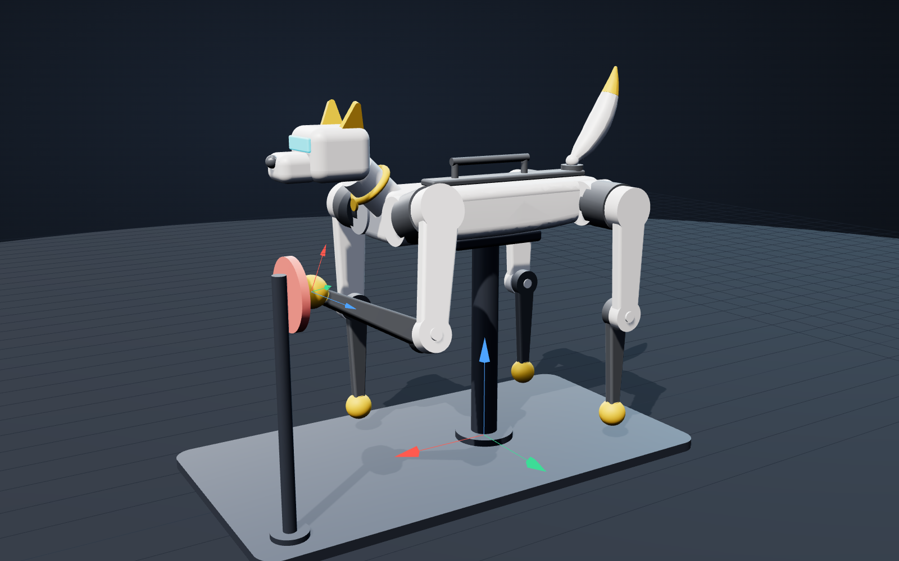

# Sprocket Kinematics Missions



A marketplace for the [Interactive Missions](https://github.com/matlab/agentic-learning-missions) toolbox with one mission:

**Teach a Robot Dog to High-Five with KinematicsSolver**

The learner imports Sprocket, a robot dog built as a real CAD assembly, into Simscape Multibody and poses him with `simscape.multibody.KinematicsSolver`. It has 14 tasks and takes about 60 minutes. It is written for people who know MATLAB and have no Simscape Multibody, robotics or CAD background. Every task gives you four things: the background, the function that you need with its general syntax, why you need it, and the task itself.

You work in a live script. When the mission starts, `sprocket_high_five.m` opens in the Live Editor. It has one section for each task, with the background, the function and an empty code area. The tutor gives you the task in the chat. You type your code in the section, run it, and tell the tutor. You can ask the tutor for a hint at any time: the first hint of every task explains the function again and gives the exact commands. The exact commands of every task are also in the Solutions section at the bottom of the live script, so you can try first and still look.

**Status: draft.** The URDF imports, the model opens in MATLAB, the marketplace registers in the app, and all 14 tasks pass in a play-through with the tutor. The replay of the move in the last task and the ten-row check script are still to be confirmed.

## Run the mission

| Step | Do this |
|---|---|
| 1 | Install the Interactive Missions toolbox, Simscape Multibody, an agent client (Claude Code, Codex, Copilot or Gemini) and the Simulink Agentic Toolkit, which sets up the MATLAB MCP Server |
| 2 | Open **Interactive Missions** from the MATLAB Apps Gallery. In **Marketplace settings**, add this repository's clone URL, then **Refresh** |
| 3 | Pick the Sprocket card. **Start Mission** saves progress, **Practice** does not. Choose your agent client |
| 4 | The app shows a `cd` line for your mission workspace. Run it in a terminal and start the agent in that folder |
| 5 | Start the tutor: `/mission-tutoring` in Claude Code, `$mission-tutoring` in Codex. Other clients follow the prompt the app shows |
| 6 | Work in the live script that opens, `sprocket_high_five.m`. The tutor gives you one task at a time. Read the section of that task, type your code in it and run the section with Ctrl+Enter. Tell the tutor when you are done, or ask for a hint |

Supported releases: R2026a and later, because the live script is saved as plain text. Products: MATLAB, Simulink, Simscape, Simscape Multibody.

### If adding the marketplace fails

If the app answers `Unrecognized field name "Id"` when you add the link, its list of registered marketplaces has not been created yet. Run this once in the MATLAB Command Window, add the link again, then close and reopen the app:

```matlab
f = fullfile(prefdir,"InteractiveMissions","app","installed_marketplaces.json");
if ~isfile(f)
    if ~isfolder(fileparts(f)), mkdir(fileparts(f)); end
    writelines('{"Marketplaces":[]}', f);
end
```

It only creates the file when it is missing, so existing marketplaces are left alone.

### How the tutor decides what to show

The tutor follows its own skill, which the toolbox copies into your mission workspace. With the standard skill, the tutor presents the goal of each task in its own words and gives one hint each time you ask. A mission cannot fix the wording that the tutor uses. This mission is built for that. Each task is one idea with one to three commands, its title names the function to use, and the text is split by where it is shown as written:

| Where | What it holds | How fixed the wording is |
|---|---|---|
| The tutor, in the chat | The task and the reason, in words, with no commands | The tutor may reword it. It is short and has no commands, so there is little to cut |
| The live script, one section for each task | The background, the function with its general syntax, why, and the code area where you type | Fixed. It is a file in your workspace |
| The first hint of each task | The function again, the task and the exact commands | The tutor quotes hints or restates them closely |
| Solutions, at the bottom of the live script | The exact commands of every task, as text | Fixed. It is in the same file |

The live script in your workspace folder is yours. It is saved as plain text, so the tutor can read your code when you ask for help.

The tutor still checks each task, answers your questions and asks a question after the tasks where there is something to notice.

There is also an optional change to the tutor itself. If you want the tutor to show the command of every task up front, add the guided walkthrough section in `docs/guided-mode-addendum.md` to the tutor skill of your installed toolbox. It only takes effect for missions that declare `teaching_mode: guided_walkthrough`. Run this once in MATLAB, then start the mission again:

```matlab
skill = fullfile(interactiveMissions.internal.toolboxRoot(),"src","skills","mission-tutoring","SKILL.md");
backup = fullfile(prefdir,"mission-tutoring-SKILL-original.md");
if ~isfile(backup), copyfile(skill,backup); end
extra = webread("https://raw.githubusercontent.com/swoday/sprocket-kinematics-missions/main/docs/guided-mode-addendum.md", weboptions(ContentType="text"));
if ~contains(fileread(skill),"Guided Walkthrough Mode"), writelines([string(fileread(skill)); string(extra)], skill); end
```

To undo it, run `copyfile(backup,skill)`. This changes your local copy of the toolbox only, and it has not been tested with every agent client.

## What the mission teaches

| Tasks | Stage | Idea |
|---|---|---|
| 1 to 2 | Import the CAD assembly and look at it | A URDF file and its part files become a Simscape Multibody model |
| 3 to 4 | Create the solver and find the leg joints | The solver names joint variables itself; they are not the joint names |
| 5 to 6 | Tell the solver where the paw is | Frame variables measure one frame from another |
| 7 to 8 | Forward kinematics into the ready stance | Joint angles in, paw position out |
| 9 to 10 | Inverse kinematics to the pad | Paw position in, joint angles out |
| 11 | Pick the pose the real joints can reach | The solver ignores joint limits; an initial guess picks the answer |
| 12 to 14 | Plan the move from stance to high-five | Solve along a path, each answer seeding the next. The viewer shows one pose at a time, so a loop replays the path to show the move |

## What is in this repository

| Folder | Contents |
|---|---|
| `marketplace/` | The marketplace manifest and the mission: `mission.yaml`, the setup script, the reset scripts, the live script that learners work in (`sprocket_worksheet.m`), the URDF and the STL parts |
| `cad/` | The parametric CAD source (`build_sprocket.py`, CadQuery), STEP parts, a coloured STEP assembly, and the reference kinematics (`kinematics.py`, `mission_numbers.json`) |
| `matlab/` | A worked solution and `verify_sprocket_mission.m`, which runs the whole mission and compares it with the reference numbers |
| `viewer/` | An interactive 3D viewer of the assembly and the mission. Open `Sprocket_viewer.html` in a browser (needs internet for three.js) |
| `tools/` | `mission_tasks.py` (the task list), `build_mission.py` (writes the mission file, the live script and the reset scripts from it) and `validate_mission.py` (static checks) |
| `docs/img/` | Renders |

Spoiler warning for learners: `matlab/` holds a full worked solution.

## For authors

| To do this | Run |
|---|---|
| Check the mission end to end in MATLAB | `matlab/verify_sprocket_mission.m` (ten rows, all should pass) |
| Change a task, the live script or a reset script | Edit the task list in `tools/mission_tasks.py`, then run `python3 tools/build_mission.py`. It writes `mission.yaml`, `sprocket_worksheet.m` and the reset scripts together |
| Check the mission files without MATLAB | `python3 tools/validate_mission.py` (needs PyYAML) |
| Change the geometry | `pip install cadquery`, then `python cad/build_sprocket.py` |
| Refresh the reference numbers and the viewer | `python3 cad/kinematics.py`, then `python3 viewer/build_viewer.py` |

The CAD files travel inside the mission's `task_reset_sprocket-high-five/` folder because the app copies only the mission file, the setup script, the thumbnail and that folder into a learner workspace.

`source_url` in `marketplace/manifest.yaml` must hold this repository's clone URL. The app refuses to register a marketplace while it is empty.
